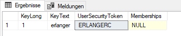
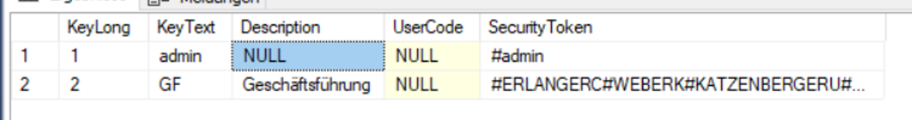
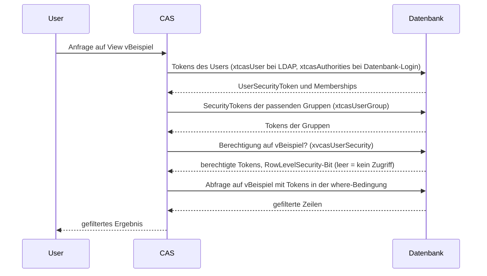

# Sicherheitsmechanismen

## Anforderungen an den Betrieb

Es wird standardmäßig HTTP und Basic Authentication verwendet.
Der Zugriff auf das CAS **muss** über einen Proxy erfolgen, der den Traffic entsprechend verschlüsselt.
Zudem sollten keine weiteren Teilnehmer Zugriff auf das Netzwerk des CAS haben.

## SecurityToken

Jeder User erhält beim Login eine Reihe von SecurityTokens:

* die Gruppen aus dem Active Directory (bei `login_dataSource=ldap`),
* die Memberships aus `xtcasUser`,
* einen eindeutigen eigenen Token (`UserSecurityToken`),
* zusätzlich **alle Tokens der Gruppen**, deren `KeyText` einem dieser Tokens entspricht (siehe unten).

Der User mit seinem Namen, seinem eigenen Token und seinen Memberships steht in der Tabelle `xtcasUser`:

```sql
select KeyLong, KeyText, UserSecurityToken, Memberships from xtcasUser
```

* **KeyText**: der Login-Name des Users.
* **UserSecurityToken**: der eindeutige Token des Users, z.B. `#JAL`. Es gibt keine feste Vorgabe, woher der Wert stammt
  (Kürzel, Mitarbeiterkürzel, Login-Name). Eine Verbindung zu `tEmployee` besteht nicht automatisch.
* **Memberships**: ein String aus Tokens, jeweils mit `#` getrennt, z.B. `#admin#gruppe1`.



Je nach `login_dataSource` kommen die Tokens aus unterschiedlichen Quellen:

| `login_dataSource` | Quelle |
|---|---|
| `ldap` | `xtcasUser` (UserSecurityToken, Memberships) und die AD-Gruppen des Users. |
| `database` | `xtcasAuthorities` (`Username`, `Authority`). `xtcasUser` wird **nicht** gelesen. |
| `oidc` | Anmeldung über einen externen Identity Provider (OpenID Connect). Die Rollen aus dem Token des Providers werden zu Authorities. `xtcasUser` und `xtcasAuthorities` werden nicht gelesen. Fehlende Gruppen legt CAS in `xtcasUserGroup` ohne Rechte an, siehe [`Authentication.md`](../../../doc/md/Authentication.md). |

Existiert für den eingeloggten User kein Eintrag, gilt sein Benutzername als eigener Token.
Die AD-Gruppen zählen ebenfalls zu den Tokens und werden in jedem Fall gegen die Datenbank abgefragt
(siehe [`adGroupsToUserGroups.md`](../adoc/adGroupsToUserGroups.md)).

Über die Tabelle `xtcasUserGroup` erhält der User dann die Tokens der Gruppen:

```sql
select KeyText, SecurityToken from xtcasUserGroup
```

* **KeyText**: der Name der Gruppe. Sie wirkt, wenn er einem Token des Users entspricht (Memberships, eigener Token oder AD-Gruppe).
* **SecurityToken**: die Tokens, die **jedes Mitglied zusätzlich erhält**, ebenfalls mit `#` getrennt (max. 250 Zeichen).
  Damit darf ein Mitglied die Zeilen sehen, die zu diesen Tokens gehören.



> **Achtung:** Eine Gruppe mit den Tokens `#a#b#c` lässt *jedes* Mitglied die Zeilen von a, b und c sehen.
> Soll jeder nur seine **eigenen** Zeilen sehen, braucht jeder User eine eigene Gruppe (`KeyText` = sein Token, `SecurityToken` = `#<Token>`),
> keine gemeinsame Gruppe mit allen Tokens. Ist der Token der Login-Name, genügt eine Gruppe mit dem Platzhalter `$user`
> (z.B. `#$user#G_SIS_User`, siehe [`RowLevelSecurity.md`](../../../doc/md/RowLevelSecurity.md)).

## Tabellenzugriffserlaubnis

Bei jedem Aufruf von `getIndexView(Table inputTable)` wird in der View `xvcasUserSecurity` nach den nötigen Berechtigungen gesucht.
Das geschieht in `checkPrivilege(Table inputTable)` in folgender Form:

```sql
select PrivilegeKeyText, SecurityToken, RowLevelSecurity from xvcasUserSecurity
where (PrivilegeKeyText = 'inputTable.getName()' and SecurityToken like '%#admin%')
or    (PrivilegeKeyText = 'inputTable.getName()' and SecurityToken like '%#verwaltung%')
or    ...
```

* **PrivilegeKeyText**: Name der View/Prozedur/Tabelle, auf die der User zugreifen möchte.
* **SecurityToken**: Token der Gruppe, die zu einem Token des Users passt.
* **RowLevelSecurity**: Bit, das angibt, ob diese Gruppe nur bestimmte Zeilen sehen darf, siehe [Row-Level-Security](#row-level-security).

Diese Liste von Tripeln wird an die weiteren Methoden gereicht. Ist sie leer, hat der User keinen Zugriff.

## Row-Level-Security

Ausführlich mit Beispiel: [`RowLevelSecurity.md`](../../../doc/md/RowLevelSecurity.md).

Da jeder User mehrere SecurityTokens hat, ergänzt CAS am Ende der Abfrage eine WHERE-Bedingung.
Anhand der Liste aus [Tabellenzugriffserlaubnis](#tabellenzugriffserlaubnis) wird geprüft, ob eine Gruppe `RowLevelSecurity = 0` hat.
Falls ja, sieht der User **alle** Zeilen. Falls nicht, nur die Zeilen mit passendem SecurityToken:

```sql
select [...] from vBeispielView
where [...]
and ( ( SecurityToken IS NULL )
   or ( SecurityToken IN ('admin', [...]) ) )
```

Dafür braucht die View eine Spalte `SecurityToken`. Zeilen mit `SecurityToken = NULL` darf **jeder** User sehen.

Der Ablauf noch einmal als Diagramm:



> **Wichtig:** Haben zwei Gruppen einen gemeinsamen SecurityToken und nur eine von beiden hat eine bestimmte Berechtigung,
> erhält die andere Gruppe sie ebenfalls, da sie sich den Token teilt. Die eine Gruppe wird dadurch de facto zur Untergruppe der anderen.

## Column-Level-Security

Mit der Liste aus [Tabellenzugriffserlaubnis](#tabellenzugriffserlaubnis) wird zuerst ermittelt, welche Gruppen überhaupt auf die Tabelle zugreifen dürfen.
Mit deren Tokens wird in `xtcasColumnSecurity` geprüft, ob einer davon die gesamte Tabelle sehen darf.
Falls nicht, werden die erlaubten Spalten ermittelt:

```sql
select KeyLong, TableName, ColumnName, SecurityToken from xtcasColumnSecurity
where (TableName = 'vBeispielView' and SecurityToken = 'admin')
or    (TableName = 'vBeispielView' and SecurityToken = 'verwaltung')
or    ...
```

* **TableName**: Name der Tabelle/View, auf deren Spalten der User zugreifen möchte.
* **ColumnName**: Name der freigegebenen Spalte.
* **SecurityToken**: Token der Gruppe oder des Users, der die Spalte sehen darf.

## Speichern von Datensätzen durch eine Prozedur

Die RowLevelSecurity filtert bei Prozeduren nur das **Ergebnis** (und nur, wenn es eine Spalte `SecurityToken` enthält).
Das Ausführen von Insert/Update/Delete wird dadurch **nicht** verhindert. Deshalb muss jede schreibende Prozedur

1. den SecurityToken des Users beim Anlegen mitspeichern (sonst ist der Eintrag für alle sichtbar),
2. den SecurityToken beim Ändern nicht überschreiben,
3. fremde Datensätze selbst abweisen.

Der Prozedur steht der Benutzername über `dbo.xfCasUser()` und die Authorities des Users über `session_context(N'casAuthorities')` zur Verfügung
(Format `#a#b#c#`, siehe [`RowLevelSecurity.md`](../../../doc/md/RowLevelSecurity.md)). Als Token eignet sich der Login-Name.
Beispiel aus der Stundenerfassung (`xpcorInsertWorkingTime`):

```sql
insert into tJournal (
	ServiceProviderKey,
	[...]
	RenderedQuantityUnitKey,
	SecurityToken
) values (
	@ServiceProviderKey,
	[...]
	@UnitKey,
	dbo.xfWorkingTimeSecurityToken()   -- Login-Name des Users (dbo.xfCasUser())
)
```

Die vollständige Umsetzung (Funktionen, Update/Delete-Prüfung, Gruppen) steht in
[`aero.minova.workingtime/doc/md/rowlevelsecurity.md`](https://github.com/minova-afis/aero.minova.workingtime/blob/main/doc/md/rowlevelsecurity.md).

## SQL Injection

Sowohl beim Aufruf von `data/procedure` als auch von `data/index` werden Prepared Statements verwendet.
Beim Befüllen der Statements wird außerdem geprüft, ob der Typ des Values mit dem Typ der angefragten Spalte übereinstimmt.
